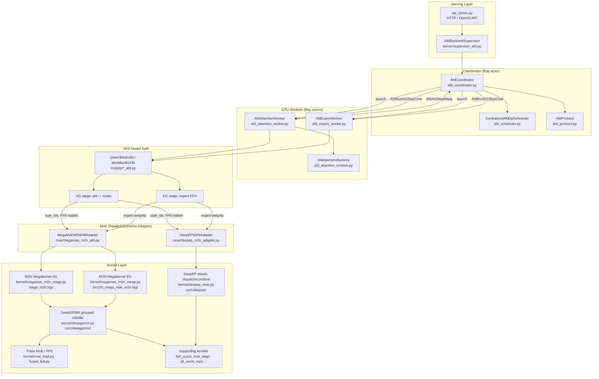

# FastAFD Architecture

This document maps every major component in the repository, explains how the
AFD (Attention–FFN Disaggregation) system fits together, and shows exactly how
the megakernels and other kernels relate to the AFD serving pipeline.

---

## Table of Contents

1. [Repository Layout](#repository-layout)
2. [AFD Architecture Overview](#afd-architecture-overview)
3. [Runtime Components](#runtime-components)
   - [Coordinator](#coordinator)
   - [Attention Worker (AG)](#attention-worker-ag)
   - [Expert Worker (EG)](#expert-worker-eg)
   - [Worker Launcher](#worker-launcher)
4. [Kernel Stack](#kernel-stack)
   - [DeepEP — dispatch/combine transport](#deepep--dispatchcombine-transport)
   - [DeepGEMM — grouped GEMM engine](#deepgemm--grouped-gemm-engine)
   - [M2N Megakernel — AG and EG role kernels](#m2n-megakernel--ag-and-eg-role-kernels)
   - [Supporting kernels](#supporting-kernels)
5. [MoE Backend Adapters](#moe-backend-adapters)
6. [Model and Layer Stack](#model-and-layer-stack)
   - [Layer primitives](#layer-primitives)
   - [MoE layer internals](#moe-layer-internals)
   - [AFD model splits](#afd-model-splits)
7. [Serving Stack](#serving-stack)
   - [Server and supervisor](#server-and-supervisor)
   - [Engine](#engine)
   - [Scheduler](#scheduler)
   - [KV cache](#kv-cache)
8. [Micro-Batch Ping-Pong Pipeline](#micro-batch-ping-pong-pipeline)
9. [Component Dependency Graph](#component-dependency-graph)
10. [Environment Variables Reference](#environment-variables-reference)

---

## Repository Layout

```
FastAFD/
├── python/minisgl/           # All Python source (the "mini-sglang" runtime)
│   ├── afd_coordinator.py    # Central coordinator — owns scheduling and step dispatch
│   ├── afd_scheduler.py      # Centralized AFD decode/prefill scheduler
│   ├── afd_protocol.py       # Dataclasses for AG/EG step plans, replies, topology
│   ├── afd_attention_worker.py   # Ray actor: attention-side GPU loop
│   ├── afd_attention_runtime.py  # Plan materializer / KV-page bookkeeping (AG)
│   ├── afd_expert_worker.py      # Ray actor: expert-side GPU loop
│   ├── afd_worker_base.py        # Shared base for AG and EG worker actors
│   ├── afd_worker_launcher.py    # Spawns and wires all Ray workers
│   ├── afd_support.py            # Ray runtime env, sizing helpers, port picking
│   ├── afd_profiler.py           # Nsight Systems capture helpers
│   ├── core.py               # Req, Batch, Context, SamplingParams
│   ├── env.py                # MINISGL_* env-var registry
│   ├── engine/               # EngineConfig, GraphRunner, Sampler
│   ├── kernel/               # Python wrappers + vendored C++/CUDA kernels
│   ├── layers/               # Reusable layer ops (attention, norm, MoE, …)
│   ├── models/               # Full model graphs (dense + AFD-split variants)
│   ├── moe/                  # High-level MoE dispatch/combine adapters
│   ├── scheduler/            # Decode/prefill request managers
│   ├── kvcache/              # KV page pool implementations
│   ├── attention/            # FlashInfer / TRT-LLM attention backends
│   ├── distributed/          # TP/EP process-group helpers
│   ├── server/               # HTTP API, supervisors, launch entry point
│   ├── message/              # Frontend↔backend message types (ZMQ)
│   └── tokenizer/            # Tokenizer process wrapper
│
├── scripts/                  # Shell scripts: serve, validate, experiments
│   ├── quickstart/           # Single-node smoke-test launcher
│   ├── serve/                # mini-sgl, FastAFD, and vLLM server launchers
│   ├── validate/             # mini-sgl/vLLM and FastAFD/vLLM alignment pipelines
│   ├── experiments/afd/      # Large-scale AFD experiment presets
│   └── data_gen/             # Prompt generation helper
│
├── deploy-afd-k8s/           # Kubernetes deployment manifests
├── prompts/                  # Pre-generated 512-prompt sets for benchmarks
├── assets/                   # Diagrams and images used by README.md
├── environment.cuda130.yml   # Conda env (CUDA 13.0, aarch64)
└── pyproject.toml            # Package metadata
```

---

## AFD Architecture Overview

FastAFD splits every MoE decode step across two classes of GPU workers:

| Role | Short name | Owns |
|---|---|---|
| **Attention Server** | AG (Attention Group) | Embedding, QKV attention, KV cache, routing gate, sampling, token output |
| **Expert Server** | EG (Expert Group) | MoE expert FFN (grouped GEMM) execution |

The key insight is that expert computation is dense and compute-bound when
aggregated from many attention servers, while attention is memory-bandwidth-bound
and individually cheap. Separating these roles lets both sides run at higher
utilization simultaneously.

**Token flow for one decode step:**

```
AG ranks                              EG ranks
─────────────────────                 ─────────────────────────────────
 Embed → Attention (QKV+KV cache)
 → RMSNorm → Router gate
 → topk_ids / topk_weights
 → [FP8 quant + N2M dispatch] ──────► Receive dispatched FP8 tokens
                                       → Grouped GEMM (gate proj + up proj
                                         + SwiGLU + down proj)
                                       → [M2N combine send] ─────────────►
 Receive BF16 expert outputs ◄─────────────────────────────────────────
 → residual add → LM head → sample
```

The N2M and M2N communication is handled either by **DeepEP** (per-layer
dispatch+combine calls) or by the **M2N Megakernel** (one fused persistent
kernel per side per micro-batch).

---

## Runtime Components

### Coordinator

**Files:** [`python/minisgl/afd_coordinator.py`](python/minisgl/afd_coordinator.py),
[`python/minisgl/afd_scheduler.py`](python/minisgl/afd_scheduler.py),
[`python/minisgl/afd_protocol.py`](python/minisgl/afd_protocol.py)

The coordinator is a **single Ray actor** that owns all control-plane logic. It
never touches the GPU. Its responsibilities are:

- **Scheduling**: maintains the full request table via
  `CentralizedAfdDpScheduler` (decode + prefill managers, table manager, KV
  page ledger). It runs one step ahead of the GPU, preparing the next decode
  plan while the current one executes.
- **Step dispatch**: serializes step plans into `AfdRunAGStepCmd` /
  `AfdRunEGStepCmd` messages and pushes them to worker actors over ZMQ.
- **Reply collection**: receives `AfdAGStepReply` from attention workers,
  detokenizes sampled tokens, routes results back to clients.
- **Profiler control**: starts/stops Nsight Systems capture via `afd_profiler.py`.

Protocol data types in `afd_protocol.py`:

| Type | Direction | Purpose |
|---|---|---|
| `AfdTopology` | static | AG/EG rank/DP/TP layout description |
| `AfdModelPlan` | coord→worker | Model config for worker initialization |
| `AfdRunAGStepCmd` | coord→AG | Full decode plan for one micro-batch step |
| `AfdRunEGStepCmd` | coord→EG | Expert-step trigger (micro-batch slot) |
| `AfdAGStepReply` | AG→coord | Sampled tokens + completion flags |
| `AfdEGStepPlan` / `AfdEGStepReply` | EG internal | Expert step metadata |
| `AfdFlushStepCmd` | coord→both | Drain in-flight micro-batches |
| `AfdStopCmd` | coord→both | Graceful shutdown |

### Attention Worker (AG)

**Files:** [`python/minisgl/afd_attention_worker.py`](python/minisgl/afd_attention_worker.py),
[`python/minisgl/afd_attention_runtime.py`](python/minisgl/afd_attention_runtime.py)

Each AG worker is a **Ray actor** pinned to one GPU on an attention node. It
owns:

- `AfdAttentionState` — device setup, TP communicator, KV cache pool, attention
  backend (FlashInfer or TRT-LLM).
- `AfdAttentionRuntime` — plan materializer: translates coordinator-provided
  `AfdAGStepPlan` into a `Batch` with KV page allocations, H2D-staged token
  ids, attention metadata, and sampling args. Does not run the model itself.
- `AfdAgDecodeGraphRunner` — wraps CUDA graph capture and replay for the
  attention-side forward pass.

The hot loop inside the worker:
1. Pull `AfdRunAGStepCmd` from ZMQ.
2. Materialize the plan → `Batch`.
3. Run the AG model stage (embed + attn + router, via `qwen3_moe_afd.py`'s
   `forward_attention` + `route`).
4. Trigger MoE dispatch (N2M) via the active MoE adapter.
5. Wait for M2N combine return from EG.
6. Sample + push `AfdAGStepReply` back to coordinator.

### Expert Worker (EG)

**File:** [`python/minisgl/afd_expert_worker.py`](python/minisgl/afd_expert_worker.py)

Each EG worker is a **Ray actor** pinned to one GPU on the MLP node. It owns:

- `AfdExpertState` — device, stream, TP communicator, global context.
- `AfdEgDecodeGraphRunner` — optional CUDA graph for the expert forward.

The hot loop:
1. Pull `AfdRunEGStepCmd` from ZMQ.
2. Wait for N2M tokens dispatched by AG workers to land in the DeepEP/Mega
   symmetric buffer.
3. Run the EG model stage (expert GEMM pipeline, via `qwen3_moe_afd.py`'s
   `run_experts`).
4. Push M2N combine output back to AG buffers.
5. Push `AfdEGStepReply` back to coordinator.

### Worker Launcher

**File:** [`python/minisgl/afd_worker_launcher.py`](python/minisgl/afd_worker_launcher.py)

`startup_afd_workers()` is called once by the coordinator at startup. It:

1. Queries Ray for available nodes and maps logical AG/EG DP/TP ranks to
   physical Ray node IPs via `afd_dp_node_layout()`.
2. Builds per-node Ray runtime environments (conda path, CUDA env, JIT cache
   dirs, Nsight options).
3. Spawns `AfdAttentionWorker` and `AfdExpertWorker` Ray actors with the
   correct GPU resource constraints and node affinity.
4. Waits for `AfdWorkerReadyReply` from every actor before returning.

---

## Kernel Stack

All compiled kernels live under
[`python/minisgl/kernel/`](python/minisgl/kernel/), with vendored C++/CUDA
source under [`python/minisgl/kernel/csrc/`](python/minisgl/kernel/csrc/).

### DeepEP — dispatch/combine transport

**Python wrapper:** [`python/minisgl/kernel/deepep_moe.py`](python/minisgl/kernel/deepep_moe.py)  
**C++ source:** [`python/minisgl/kernel/csrc/deepep/`](python/minisgl/kernel/csrc/deepep/)  
**Vendored from:** [DeepSeek DeepEP](https://github.com/deepseek-ai/DeepEP) (MIT)

DeepEP provides the elastic-buffer V2 all-to-all dispatch/combine primitives.
FastAFD uses the **hybrid (NVLink + NCCL) path** for intra-node and cross-node
token routing. Key concepts:

- **Elastic buffer** (`DeepEPMoeElasticBuffer`) — a pre-allocated symmetric
  GPU buffer that holds tokens during flight; allows variable token counts
  without dynamic allocation.
- **Dispatch** — AG ranks scatter routed FP8 tokens + top-k metadata to EG
  ranks over NVLink/MNNVL.
- **Combine** — EG ranks write expert outputs back into AG-owned combine
  buffers; AG ranks reduce top-k results.

The Python wrapper JIT-compiles the extension from source on first import using
`nvcc`, caching the `.so` in `~/.cache/minisgl/deepep/`.

### DeepGEMM — grouped GEMM engine

**Python wrapper:** [`python/minisgl/kernel/deepgemm.py`](python/minisgl/kernel/deepgemm.py)  
**C++ source:** [`python/minisgl/kernel/csrc/deepgemm/`](python/minisgl/kernel/csrc/deepgemm/)  
**Vendored from:** [DeepSeek DeepGEMM](https://github.com/deepseek-ai/DeepGEMM) (MIT)  
**Third-party deps:** NVIDIA CUTLASS (headers), {fmt}

DeepGEMM provides:
- **FP8 grouped GEMM** — SM90 (H100) and SM100 (B200/GB200) tile-scheduled
  grouped matrix multiplications with per-block FP8 scaling.
- **Mega-MoE kernel** — the SM100 persistent MoE kernel (gate + up proj
  fused in L1, SwiGLU epilogue, down proj in L2) used by the colocated path.
- **M2N Megakernel** (FastAFD addition) — the split AG/EG role kernels
  described next.

The wrapper JIT-compiles the extension on first import, caching under
`~/.cache/minisgl/deepgemm/`. The environment variable
`MINISGL_DEEPGEMM_BUILD_DIR` overrides the cache path.

### M2N Megakernel — AG and EG role kernels

This is FastAFD's primary kernel innovation. It fuses the entire
dispatch→expert→combine round-trip into **two role-specialized persistent
kernels** that run simultaneously on AG and EG GPUs respectively.

#### Python layer

| File | Role |
|---|---|
| [`kernel/megamoe_m2n_mega.py`](python/minisgl/kernel/megamoe_m2n_mega.py) | Low-level wrapper: `MegaMoEM2NSymmBuffer`, `mega_moe_m2n_ag()`, `mega_moe_m2n_eg()` |
| [`moe/megamoe_m2n_afd.py`](python/minisgl/moe/megamoe_m2n_afd.py) | High-level AFD adapter: `MegaMoEM2NAfdAdapter` |

#### C++ / CUDA layer

| File | Purpose |
|---|---|
| [`csrc/deepgemm/csrc/apis/mega_m2n.hpp`](python/minisgl/kernel/csrc/deepgemm/csrc/apis/mega_m2n.hpp) | C++ API: buffer sizing, AG/EG launch entry points |
| [`csrc/deepgemm/csrc/jit_kernels/impls/sm100_mega_moe_m2n.hpp`](python/minisgl/kernel/csrc/deepgemm/csrc/jit_kernels/impls/sm100_mega_moe_m2n.hpp) | SM100 JIT kernel runtime: `SM100MegaMoEM2NAGRuntime`, `SM100MegaMoEM2NEGRuntime` |
| `deep_gemm/include/deep_gemm/impls/sm100_mega_moe_m2n.cuh` | CUDA kernel bodies (AG dispatch+combine, EG GEMM pipeline) |
| `deep_gemm/include/deep_gemm/layout/mega_moe_m2n.cuh` | Symmetric buffer layout definitions |

#### How the two role kernels work

**AG kernel** (`mega_moe_m2n_ag`, called once per step per AG rank):
1. Reads pre-staged FP8 hidden states + top-k ids/weights from the symmetric buffer.
2. Pushes token-topk index + count metadata to EG ranks over NVLink.
3. Waits for EG ranks to write expert outputs into the AG's combine buffer region.
4. Reduces top-k weighted expert outputs → BF16 output tensor `y`.

**EG kernel** (`mega_moe_m2n_eg`, called once per step per EG rank):
1. Persistent kernel: waits for tokens from AG ranks to arrive in the shared pool.
2. Runs the two-stage grouped GEMM pipeline (gate+up proj → SwiGLU → down proj)
   using SM100 tensor-core instructions with UE8M0 FP8 scaling.
3. Writes combined BF16 outputs directly into the source AG rank's combine buffer.

Both kernels communicate entirely through the **`MegaMoEM2NSymmBuffer`** — a
symmetric tensor allocated via `torch.distributed._symmetric_memory` (NVLink
fabric, identical layout on every union rank). This eliminates separate
dispatch and combine launches, reducing per-layer kernel count from ~5 to 2.

**Constraints:** `hidden_size % 512 == 0` and `moe_intermediate_size % 512 == 0`
(satisfied by Qwen3-235B with hidden=4096, intermediate=1536×2=2048 effective;
not yet satisfied by Qwen3-30B's intermediate=768).

### Supporting kernels

| File | Purpose |
|---|---|
| [`kernel/fp8_quant.py`](python/minisgl/kernel/fp8_quant.py) | Per-token and per-channel FP8 cast / quantization helpers |
| [`kernel/deepgemm_fused_quant.py`](python/minisgl/kernel/deepgemm_fused_quant.py) | Fused SiLU+mul+quant kernels used in DeepGEMM grouped MoE path |
| [`kernel/moe_align.py`](python/minisgl/kernel/moe_align.py) | `moe_align_block_size` — sorts tokens into expert-contiguous layout for the Triton runner |
| [`kernel/moe_topk.py`](python/minisgl/kernel/moe_topk.py) | Fast top-k selection helpers for routing |
| [`kernel/moe_impl.py`](python/minisgl/kernel/moe_impl.py) | Triton fused MoE kernel host wrapper (BF16 baseline path) |
| [`kernel/qk_norm_rope.py`](python/minisgl/kernel/qk_norm_rope.py) | Fused QK-norm + RoPE kernel (used by Qwen3 / MiniMax) |
| [`kernel/minimax_qk_norm.py`](python/minisgl/kernel/minimax_qk_norm.py) | MiniMax-specific QK-norm variant |
| [`kernel/radix.py`](python/minisgl/kernel/radix.py) | Radix cache prefix-matching kernels |
| [`kernel/index.py`](python/minisgl/kernel/index.py) | Gather/scatter index utilities |
| [`kernel/store.py`](python/minisgl/kernel/store.py) | KV cache store/load helpers |
| [`kernel/pynccl.py`](python/minisgl/kernel/pynccl.py) | PyNCCL all-reduce wrapper for TP |
| [`kernel/triton/`](python/minisgl/kernel/triton/) | Triton kernel sources (fused MoE, sum-reduce, etc.) |

---

## MoE Backend Adapters

**Directory:** [`python/minisgl/moe/`](python/minisgl/moe/)

These adapters decouple the model-level MoE dispatch/combine API from the
underlying kernel. The active backend is selected via
`MINISGL_AFD_MOE_BACKEND`.

```
minisgl/moe/
├── base.py              # BaseMoeBackend ABC (colocated path)
├── fused.py             # Triton BF16 baseline runner
├── fused_fp8.py         # Triton FP8 grouped MoE runner (vendored from vLLM)
├── deepep_m2n_union.py  # DeepEPUnionM2NLayout: rank↔expert mapping math
├── deepep_m2n_adapter.py  # DeepEPM2NAdapter — per-layer dispatch/combine via DeepEP
└── megamoe_m2n_afd.py   # MegaMoEM2NAfdAdapter — fused megakernel dispatch/combine
```

### `MINISGL_AFD_MOE_BACKEND` values

| Value | Adapter | Description |
|---|---|---|
| `deepep` (default) | `DeepEPM2NAdapter` | Separate dispatch and combine calls per layer using DeepEP elastic buffers. Works on both SM90 and SM100. |
| `megamoe_m2n` | `MegaMoEM2NAfdAdapter` | Single fused AG+EG persistent kernel. SM100 (B200/GB200) only. Requires `hidden % 512 == 0` and `intermediate % 512 == 0`. |

### DeepEPM2NAdapter (deepep path)

`DeepEPM2NAdapter` wraps a single union process group (all AG ranks first,
then all EG ranks). It solves the asymmetric routing problem by assigning
**dummy expert slots** to AG ranks so that DeepEP sees a symmetric expert
layout, then remaps real expert ids via `remap_real_to_deepep_experts`.

- AG side calls: `dispatch()` → (wait for EG) → `combine()`
- EG side calls: `receive()` → run experts → `send_back()`

### MegaMoEM2NAfdAdapter (megamoe_m2n path)

`MegaMoEM2NAfdAdapter` replaces the per-layer dispatch+expert+combine triple
with a single call pair:

- AG side: `ag_moe(x, topk_ids, topk_weights) → y` — one kernel launch
- EG side: `eg_moe(w1, w2) → None` — one persistent kernel launch (returns
  when all tokens for this step have been processed and written back)

Weights are requantized once at init from the checkpoint's per-channel FP8
format to the per-32 UE8M0 mega format via `_requant_channel_weight_ue8m0_inplace`.

---

## Model and Layer Stack

### Layer primitives

**Directory:** [`python/minisgl/layers/`](python/minisgl/layers/)

| File | Provides |
|---|---|
| `base.py` | `BaseOP` — common `state_dict` / parameter interface |
| `linear.py` | `ColumnParallelLinear`, `RowParallelLinear`, `LinearReplicated` |
| `embedding.py` | `VocabParallelEmbedding`, `ParallelLMHead` |
| `norm.py` | `RMSNormFused` (uses Triton or fused CUDA norm) |
| `attention.py` | Thin wrapper; delegates to `minisgl.attention` backends |
| `rotary.py` | `RotaryEmbedding` |
| `activation.py` | `silu_and_mul`, `glm4_silu_and_mul` |

### MoE layer internals

**Directory:** [`python/minisgl/layers/moe/`](python/minisgl/layers/moe/)

```
layers/moe/
├── layer.py             # MoELayer — wires dispatcher + runner; handles EP expert_map
├── permute_registry.py  # Pre/post-permute hooks (for non-default weight layouts)
├── token_dispatcher/
│   ├── base.py          # BaseDispatcher, DispatchOutput, CombineInput protocols
│   ├── standard.py      # Simple local (no all-to-all) dispatcher
│   └── deepep.py        # DeepEPDispatcher — wraps DeepEP elastic V2 for colocated EP
└── moe_runner/
    ├── base.py           # MoeRunner ABC, MoeRunnerConfig
    ├── triton.py         # Triton BF16 grouped MoE runner
    ├── triton_fp8.py     # Triton FP8 grouped MoE runner
    └── deepgemm_grouped.py  # DeepGEMM masked grouped GEMM runner (SM90/SM100)
```

`MoELayer.forward()` calls the dispatcher's `dispatch()`, then the runner's
`forward()` on the dispatched tokens, then `combine()` — this is the colocated
(non-AFD) path. In the AFD path the `MoELayer` is not used; instead the model
split files invoke the MoE adapter directly.

### AFD model splits

**Directory:** [`python/minisgl/models/`](python/minisgl/models/)

Each supported MoE model has two variants:

| Model | Colocated | AFD split |
|---|---|---|
| Qwen3-MoE | `qwen3_moe.py` | `qwen3_moe_afd.py` |
| MiniMax M2 | `minimax_m2.py` | `minimax_m2_afd.py` |
| GLM-4 MoE | `glm4_moe.py` | `glm4_moe_afd.py` |

Each AFD split defines:

- **AG stage** — `forward_attention(hidden) → hidden` runs embed + self-attn +
  norms. `route(hidden) → (topk_ids, topk_weights)` runs the router gate.
- **EG stage** — `run_experts(dispatch_output) → expert_out` runs the grouped
  expert FFN.

The actual dispatch/combine communication lives in the worker hot-loop and MoE
adapter, not in the model file. `models/afd.py` provides the shared
`ModelStageState` dataclass and the `extract_stage_state_dict` utility for
loading per-stage weights from a full checkpoint.

---

## Serving Stack

### Server and supervisor

**Directory:** [`python/minisgl/server/`](python/minisgl/server/)

| File | Role |
|---|---|
| `launch.py` | CLI entry point (`python -m minisgl`) |
| `args.py` | `ServerArgs` — all CLI flags |
| `api_server.py` | FastAPI HTTP server (OpenAI-compatible completions API) |
| `supervisor.py` | Shared supervisor helpers (tokenizer process lifecycle, ZMQ setup) |
| `supervisor_local.py` | Local (single-node, multi-process) serving supervisor |
| `supervisor_ray.py` | Ray-based multi-node serving supervisor |
| `supervisor_afd.py` | `AfdBackendSupervisor` — bootstraps the coordinator Ray actor and starts the AFD serving path |

### Engine

**Directory:** [`python/minisgl/engine/`](python/minisgl/engine/)

| File | Role |
|---|---|
| `config.py` | `EngineConfig` — dtype, TP size, page size, distributed addresses |
| `engine.py` | `_init_tp_communication`, `_adjust_config` — shared TP init used by both local and AFD workers |
| `graph.py` | `GraphRunner` — CUDA graph capture/replay, free-memory accounting |
| `sample.py` | `Sampler`, `BatchSamplingArgs` — token sampling on GPU |

### Scheduler

**Directory:** [`python/minisgl/scheduler/`](python/minisgl/scheduler/)

| File | Role |
|---|---|
| `scheduler.py` | `Scheduler` — main loop for local (non-AFD) serving |
| `decode.py` | `DecodeManager` — decode-phase batch building |
| `prefill.py` | `PrefillManager` — prefill-phase batch building |
| `table.py` | `TableManager` — request table slot management |
| `cache.py` | `CacheManager` — KV page ledger |
| `config.py` | `SchedulerConfig` |

The AFD coordinator uses its own `CentralizedAfdDpScheduler` (in
`afd_scheduler.py`) which is a thin wrapper around the same `DecodeManager` /
`PrefillManager` / `TableManager` primitives, but runs entirely on CPU in the
coordinator process rather than in a GPU worker.

### KV cache

**Directory:** [`python/minisgl/kvcache/`](python/minisgl/kvcache/)

| File | Role |
|---|---|
| `base.py` | `BaseKVCachePool`, `BaseCacheHandle` ABCs |
| `naive_cache.py` | `NaiveKVCachePool` — simple page list, no prefix sharing |
| `radix_cache.py` | `RadixKVCachePool` — prefix-tree page sharing for repeated prompts |
| `mha_pool.py` | GPU tensor pool: allocates and manages the physical KV tensor |

In the AFD path, each attention worker owns its own `NaiveKVCachePool`
(prefix sharing is not used in the disaggregated path). The coordinator
maintains a CPU-side `_CpuNaiveCacheManager` ledger that mirrors page
allocations so it can produce correct plans without hitting the GPU.

---

## Micro-Batch Ping-Pong Pipeline

FastAFD splits each decode batch into **micro-batches** (typically 2) to
overlap communication and compute across consecutive layers:

```
Step N                   Step N+1
────────────────────     ────────────────────
AG: attn(mb=0)           AG: attn(mb=1)
AG: dispatch(mb=0) ───►  AG: dispatch(mb=1) ───►
EG:             expert(mb=0)             expert(mb=1)
AG:          ◄─── combine(mb=0)       ◄─── combine(mb=1)
AG: sample(mb=0)         AG: sample(mb=1)
```

The coordinator prepares the step plan for micro-batch N+1 while the GPU
executes micro-batch N. This keeps the critical path free of coordinator
latency.

The number of micro-batches is set by `--afd-num-micro-batches` (default 2).
Each attention worker maintains a ring of in-flight micro-batch slots; EG
workers have corresponding slots indexed by micro-batch id.

---

## Component Dependency Graph



---

## Environment Variables Reference

All FastAFD-specific variables use the `MINISGL_AFD_` prefix (read via
`afd_env()` in [`python/minisgl/env.py`](python/minisgl/env.py)).

| Variable | Default | Effect |
|---|---|---|
| `MINISGL_AFD_MOE_BACKEND` | `deepep` | MoE adapter: `deepep` or `megamoe_m2n` |
| `MINISGL_AFD_MAX_COMM_TOKENS` | _(auto)_ | Max tokens in flight per dispatch slot |
| `MINISGL_AFD_DISABLE_DEEPEP_CPU_SYNC` | `0` | Skip CPU sync after DeepEP dispatch (latency) |
| `MINISGL_DEEPEP_BUILD_DIR` | `~/.cache/minisgl/deepep` | DeepEP JIT build cache |
| `MINISGL_DEEPGEMM_BUILD_DIR` | `~/.cache/minisgl/deepgemm` | DeepGEMM JIT build cache |
| `MINISGL_AFD_CONTROL_PROFILE_START_STEP` | _(off)_ | Coordinator NVTX profiling start step |
| `MINISGL_AFD_CONTROL_PROFILE_STOP_STEP` | _(off)_ | Coordinator NVTX profiling stop step |
| `MINISGL_RAY_NSYS_BIN` | _(off)_ | Path to `nsys`; enables Nsight Systems capture |
| `MINISGL_RAY_NSYS_START_STEP` | _(off)_ | Step at which Nsight capture begins |
| `MINISGL_RAY_NSYS_STOP_STEP` | _(off)_ | Step at which Nsight capture stops |
| `MINISGL_NVTX_CPU_TRACE` | `0` | Enable CPU-side NVTX range annotations |
| `MINISGL_QK_NORM_ROPE_BACKEND` | _(auto)_ | Override QK-norm+RoPE kernel backend |
| `MINISGL_MEGAMOE_HOST_DEBUG` | `0` | Enable verbose megakernel host debug prints |
| `DG_JIT_CACHE_DIR` | `~/.cache/deepgemm` | Upstream DeepGEMM JIT kernel cache |
| `DG_JIT_NVCC_COMPILER` | _(auto)_ | Override NVCC path for DeepGEMM JIT |
| `DG_JIT_USE_NVRTC` | `0` | Use NVRTC instead of NVCC for JIT compilation |
